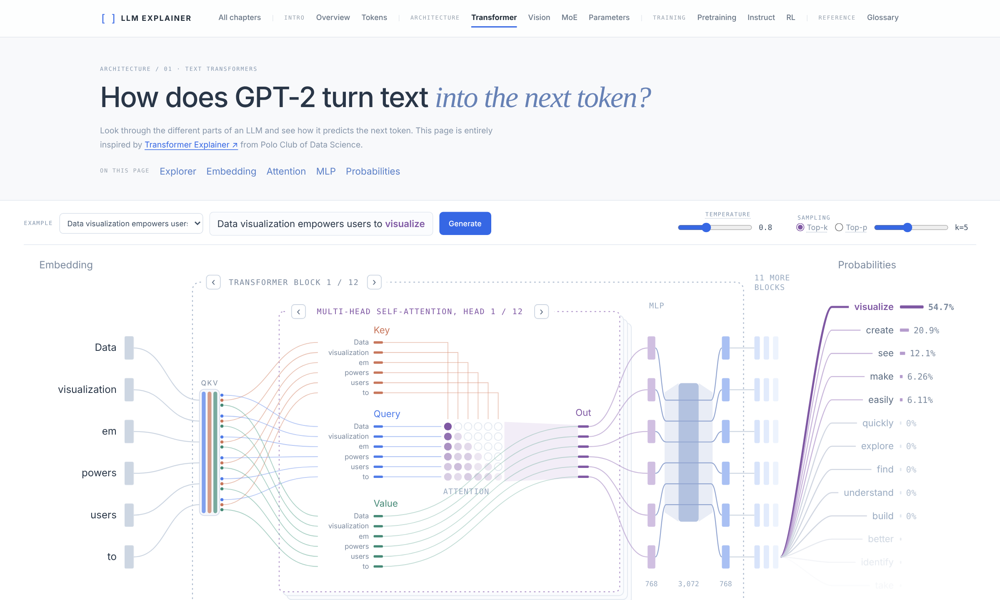

# LLM Explainer

**Live site: https://apravesh.github.io/llm-explainer/**

A visual, first-time-reader guide to how large language models work: what they do, what is inside them, and how they are trained. Every page is plain HTML, CSS and JavaScript modules. There is no framework, no build step for the site, no runtime dependency, no API key and no analytics.

[](https://apravesh.github.io/llm-explainer/transformer.html)

## Chapters

| Group | Page | File | What it shows |
| --- | --- | --- | --- |
| Intro | Overview | `what-is-an-llm.html` | The model as a black box: predict the next word, add it, repeat. Use cases (creative writing, chat, code, agents) and chat with web search. |
| Intro | Tokens | `tokenization.html` | Why models read tokens, not words. GPT-2's real tokenizer, live, and byte pair encoding step by step. |
| Architecture | Transformer | `transformer.html` | GPT-2 small, one sentence at a time: embedding, multi-head self-attention, MLP, output projection and sampling. |
| Architecture | Vision | `vision.html` | Pixtral's vision encoder in the same diagram: image to patches, attention without a mask, gated MLP, 2D RoPE, ViT vs Pixtral. |
| Architecture | MoE | `moe.html` | Mixture of experts with Mixtral 8x7B's sizes: the router, top-k, the weighted sum, stored vs used weights, how an MoE learns. |
| Architecture | Parameters | `analytics.html` | 01 Capacity (where the weights sit) and 02 Compute (where the work goes) on the same diagram, then 03 Optimizations: local and global attention layers, the KV cache and grouped-query attention. |
| Training | Pretraining | `pretraining.html` | A data pipeline, a small BPE tokenizer and a tiny transformer that really trains in the page. |
| Training | Instruct | `post-training-instruct.html` | Chat templates, demonstration data and the assistant-only loss mask. |
| Training | RL | `post-training-rl.html` | GRPO on a three-answer policy: rollouts, group advantages, updates and snapshots. |
| Reference | Glossary | `glossary.html` | 69 short definitions, each linked to the chapter that shows it, plus outside resources. |

`index.html` is the home page. Every page shares one header (`site-header.css`) with the same groups.

## Where the numbers come from

Each page says on the page itself which values are real, recorded, computed by a small stand-in, or illustrative. In short:

- **Overview.** The "box" is `src/intro-engine.mjs`, a longest-match lookup over about thirty hand-written texts. It is deliberately not a neural network. The web-search walk-through uses an invented town and websites.
- **Tokens.** `src/tokenizer-gpt2.mjs` is GPT-2's real byte-level BPE in plain JavaScript. It needs only the 50,000 merge rules in `assets/gpt2-merges.txt`, because a token's ID follows from them (0–255 are bytes, 256 + n is the token made by rule n, 50256 is end-of-text). It was checked against a reference tokenizer.
- **Transformer.** No model runs in the page. `src/text-data.mjs` holds values recorded from GPT-2 small for five example sentences: tokens and IDs, the top next-token logits, the raw attention scores for all 12 blocks × 12 heads, and for every earlier position the top predictions (`topAt`) and what GPT-2 gave the token that really follows (`nextAt`). `src/text-engine.mjs` computes the rest: scaling, causal mask, softmax, temperature, top-k, top-p and sampling. Embedding and MLP vectors were not recorded; they are drawn from a seeded generator and labelled illustrative.
- **Vision.** Sizes are Pixtral's published ones. The values in the diagram are illustrative and labelled so.
- **MoE.** Every size on the diagram is Mixtral 8x7B's (32 blocks, 32 heads of 128, width 4,096, 8 gated experts of 4,096 → 14,336 → 4,096, top 2), and the weight counts are computed from those sizes. The dots, router scores and choice of experts are real arithmetic of a much smaller untrained stand-in with the same layout (`STAND_IN` in `src/moe-page-engine.mjs`), so the mechanism is exact and the routes carry no meaning. The next-token list is illustrative.
- **Parameters.** `src/param-formulas.mjs` computes weight counts (`parameterFormulas`) and operation counts (`workFormulas`) from each model's published dimensions: GPT-2 small, Mistral 7B, Llama 3 8B, Mixtral 8x7B and Pixtral's vision encoder, or your own. Work is counted as two operations per weight used (one multiply, one add). Norm gains and biases are mostly left out, and the page says where. The long-context lab (`src/long-context.mjs`) counts token pairs and cached tokens for global and sliding-window layers; the 5 local : 1 global, window 1,024 setting is Gemma 3's and the all-local window of 4,096 is Mistral 7B's. The KV cache and grouped-query attention labs (`src/gqa.mjs`, `src/gqa-app.mjs`) are drawings with counts: which vectors are computed or reused per step, and the size of the stored Keys and Values for a given number of K/V heads. They are not memory or speed measurements.
- **Training pages.** All examples are small and local: hand-written records, a character-level BPE, a width-4 transformer that genuinely trains, and a three-logit policy that is genuinely updated. None of it is evidence about real models, and the pages say so.

## Run, test, build

Node.js 20+ is needed only for local tooling.

```sh
node server.mjs                              # http://127.0.0.1:4173 (PORT overrides)
node --no-maglev --test tests/*.test.mjs     # 745 tests
node build.mjs                               # rebuilds standalone.html
```

The server binds to loopback only. Some pages fetch files (the Tokens page loads the merge rules), so open the site through the server or GitHub Pages rather than `file://`. The `--no-maglev` flag avoids a JIT/GC hang seen with some local Node versions; browsers are not affected.

The tests cover the engines' arithmetic (attention, routing, sampling, tokenizer IDs, weight and work formulas), the recorded GPT-2 numbers, page structure and wording that is easy to get wrong, and that every chapter link and anchor resolves.

## Layout

```
*.html, *.css        one page and one stylesheet per chapter, plus site-header.css
src/*-app.mjs        what a page draws and how it reacts
src/*-engine.mjs     the arithmetic behind a page, kept free of the DOM so tests can run it
src/*-data.mjs       recorded or hand-written data
assets/              images, the GPT-2 merge rules, the screenshot above
tests/               node:test suites
```

The three architecture explorers (`src/text-app.mjs`, `src/vision-app.mjs`, `src/moe-page-app.mjs`) and the Parameters diagram (`src/param-formulas-app.mjs`) share one visual language: an SVG flow from embedding to probabilities, steppers for block and head, sections that expand in place, formulas on hover, and shared weights (Q/K/V, the MLP) drawn once for all tokens.

Two earlier pages are kept in the repository but are not linked from the site: `vision-live.html` (a full-dimension Pixtral/ViT runtime with synthetic weights, a worker and a WASM SIMD kernel, also packaged as the offline `standalone.html` by `build.mjs`) and `moe-live.html`. Many files under `src/` and `tests/` belong to them.

## Deployment

GitHub Pages serves the `main` branch from the repository root, with `.nojekyll`. Pushing to `main` publishes the site. Run the tests and `node build.mjs` before pushing.

## Credits

- The Transformer page is a retelling of [Transformer Explainer](https://poloclub.github.io/transformer-explainer/) by Polo Club of Data Science ([source](https://github.com/poloclub/transformer-explainer), MIT licence) in this site's style. Its 01 Embedding section (text and `assets/transformer-explainer/embedding.png`) is taken from that article, with credit on the page, and the recorded GPT-2 values come from the weights that project ships.
- `assets/gpt2-merges.txt` is from OpenAI's GPT-2 release (modified MIT licence).
- Model dimensions are the published ones for GPT-2, Mistral 7B, Llama 3 8B, Mixtral 8x7B and Pixtral.

This is an independent project. It is not affiliated with Georgia Tech, Polo Club, OpenAI, Meta or Mistral. Sample illustrations are original SVG artwork, and images you load stay on your device.
